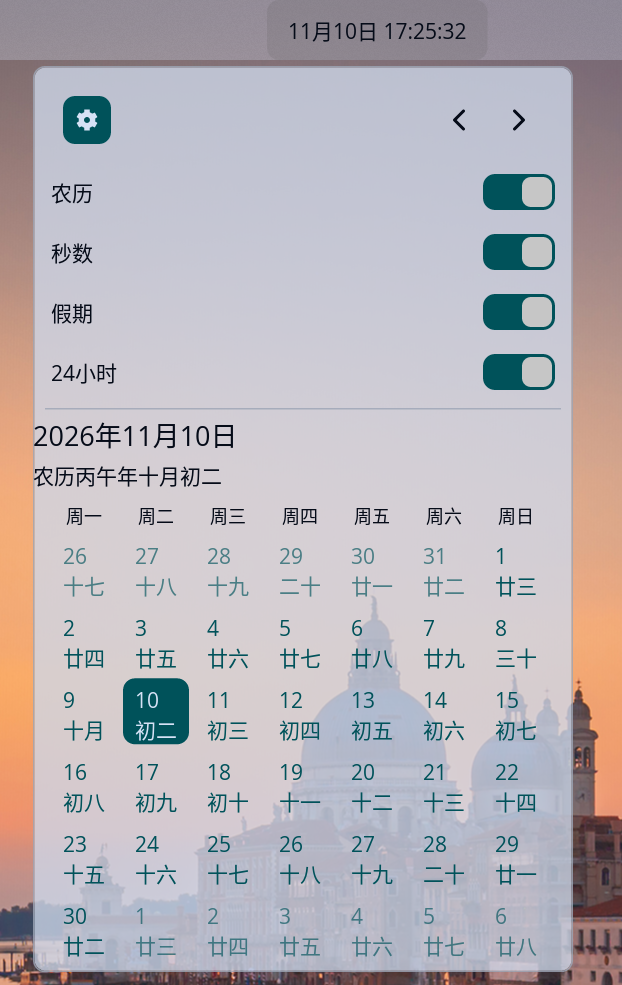
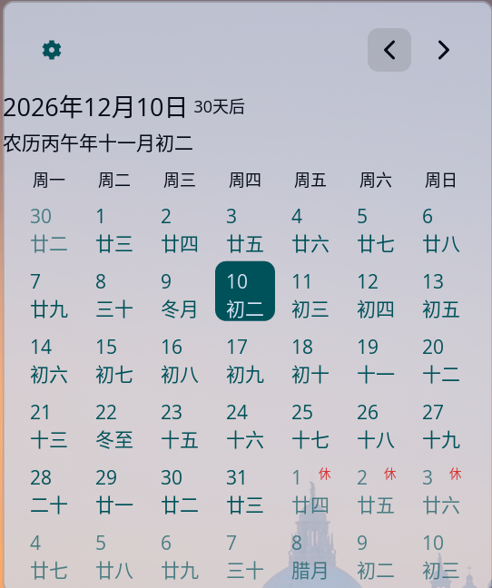
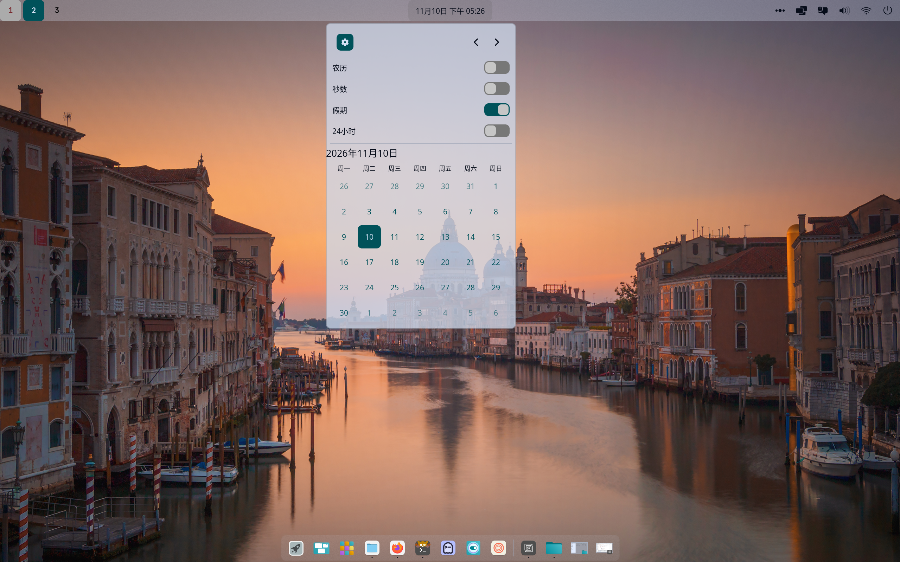

# Cosmic Ext Applet: CN Calendar (中国农历日历)

[English](#english) | [简体中文](#简体中文)

# English

A lightweight and elegant calendar applet specifically designed for the [COSMIC™ desktop environment](https://system76.com/cosmic). Beyond basic time display, it deeply integrates the Chinese Lunar Calendar, official holiday/workday adjustment markers, and localized time formatting.

### 🌟 Features

- **Basic Time Display**: Shows full date and time on the panel. Supports 12/24-hour format and optional seconds display.
- **Chinese Lunar Calendar Integration**: Optionally displays lunar dates, traditional festivals (e.g., Spring Festival, Mid-Autumn), and 24 solar terms in both the panel and the calendar popup.
- **Holidays & Workdays Markers**: Automatically marks "休" (Holiday) and "班" (Make-up Workday) in the calendar grid using eye-catching corner badges. Includes official schedules for 2026 and 2027.
- **Relative Date Calculation**: When selecting a non-current day, it automatically displays "x days after" or "x days before" for better scheduling.
- **Highly Customizable**: The popup provides a settings panel to toggle lunar calendar, seconds, holiday markers, and 24-hour format.
- **Multilingual Support**: Seamlessly integrates with system localization (i18n) for UI and date formats.
- **Perfect UI Adaptation**: Uses Autosize to perfectly fit the panel size. Displays complete information flawlessly on both horizontal and vertical panels. Weekend dates are automatically greyed out.

### 📸 Screenshots

|                 Full Lunar & Holiday                 |                 Relative Date & Badges                 |                 Compact Panel                 |
| :--------------------------------------------------: | :----------------------------------------------------: | :-------------------------------------------: |
|  |  |  |

### 🛠️ Build & Installation

#### Prerequisites

Ensure you have the Rust toolchain and the required build dependencies for the COSMIC desktop environment:
** For Arch **

```bash
sudo pacman -S base-devel git just pkg-config libxkbcommon wayland openssl
```

**For Ubuntu / Pop!\_OS:**

```bash
sudo apt update
sudo apt install build-essential git just pkg-config libxkbcommon-dev libwayland-dev libssl-dev

```

1. Clone the repository

```bash

git clone https://github.com/alenx-zheng/cosmic-ext-applet-cn-calendar.git
cd cosmic-ext-applet-cn-calendar
```

2. Build the project

Compile using cargo in release mode:

```bash

cargo build --release
```

(Note: If you have just installed, you can also run just build-release)

3. Install to system

After compilation, install the executable, desktop file, and icons to the user directory:

```bash

sudo just install

# Or manually copy target/release/cosmic-ext-applet-cn-calendar and the .desktop file to the appropriate system directories.
```

4. Enable the applet

   Restart the COSMIC panel (or log out and log back in).

   Right-click the panel -> Panel Settings -> Applets.

   Find CN Calendar in the list and add it to your panel.

📁 Data Maintenance

Holiday data is highly maintainable. All holiday and workday adjustment info is stored in the data/holidays/ directory, with one .json file per year (e.g., 2026.json, 2027.json). For future years, simply add a new JSON file and include it in the code via include_str!; no code refactoring is needed.
🤝 Contributing

Issues and Pull Requests are welcome! If you have feature suggestions or find a bug, please feel free to report it on GitHub.
📄 License

This project is licensed under the MPL-2.0 License.

# 简体中文

一个专为 [COSMIC™ 桌面环境](https://system76.com/cosmic) 开发的轻量级、高颜值的日历 Applet 插件。除了基础的时间显示，它还深度集成了中国农历、法定节假日调休标记以及本地化时间格式。

## 🌟 核心特性

- **基础时间显示**：支持在顶栏显示完整的日期与时间，支持 12/24 小时制切换，并可选择是否显示秒数。
- **中国农历集成**：可选在顶栏及日历弹窗中显示农历日期、传统节日（如春节、中秋）及二十四节气。
- **法定节假日与调休标记**：自动在日历网格中标记“休”（节假日）与“班”（调休工作日），使用醒目的右上角角标展示，包含 2026 及 2027 年官方安排。
- **相对日期计算**：选择非当天的日期时，会自动显示“xx天后”或“xx天前”，方便规划日程。
- **高度可定制**：弹窗内提供设置面板，可自由开关农历、秒数、节假日标记、24小时制等功能。
- **多语言支持**：界面与日期格式无缝接入系统本地化（i18n）。
- **完美的 UI 适配**：自适应面板尺寸（Autosize），无论水平还是垂直面板，均能完美撑开并展示完整信息，周末日期自动灰度显示。

## 📸 界面预览

|                 完整农历与节假日展示                 |                 相对日期计算与节假日角标                 |                 顶栏简洁模式                 |
| :--------------------------------------------------: | :------------------------------------------------------: | :------------------------------------------: |
|  |  |  |

## 🛠️ 编译与安装

### 前置依赖

在编译此项目之前，请确保你的系统已经安装了 Rust 环境以及 COSMIC 桌面环境所需的编译依赖：

**For Ubuntu / Pop!\_OS:**

```bash
sudo apt update
sudo apt install build-essential git just pkg-config libxkbcommon-dev libwayland-dev libssl-dev
```

**For Arch linux**

```bash
sudo pacman -S base-devel git just pkg-config libxkbcommon wayland openssl
```

1. 克隆仓库

```bash

git clone https://github.com/alenx-zheng/cosmic-ext-applet-cn-calendar.git
cd cosmic-ext-applet-cn-calendar
```

2. 编译项目

使用 cargo 进行 release 编译：

```bash

cargo build --release
```

(注意：如果你安装了 just，也可以直接运行 just build-release)

3. 安装到系统

编译完成后，需要将可执行文件和相关的桌面配置文件、图标等安装到用户目录：

```bash

sudo just install
# 或者手动复制 target/release/cosmic-ext-applet-cn-calendar 及相关 .desktop 文件到对应的系统目录
```

4. 启用组件

   重启 COSMIC 面板（或者注销并重新登录）。

   右键点击面板 -> Panel Settings (面板设置) -> Applets (小程序)。

   在列表中找到 CN Calendar 并添加到面板中。

📁 目录结构说明

维护节假日数据非常方便，所有节假日及调休信息存放在 data/holidays/ 目录下，每年一个 .json 文件（如 2026.json, 2027.json）。未来年份只需新增对应的 JSON 文件并在代码中通过 include_str! 引入即可，无需重构代码。
🤝 贡献与反馈

欢迎提交 Issue 或 Pull Request！如果你有更好的功能建议或发现了 Bug，请随时在 GitHub 上反馈。
📄 开源协议

本项目基于 MPL-2.0 协议开源。
